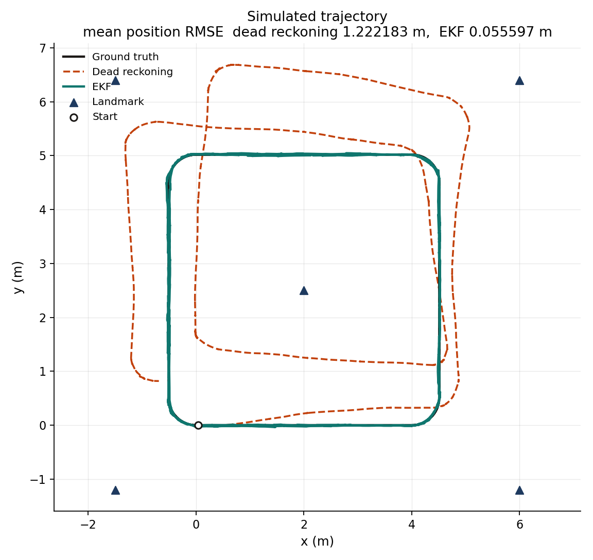
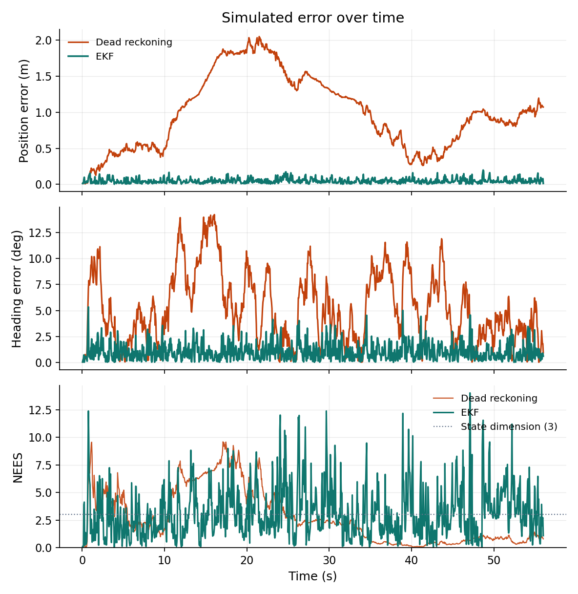
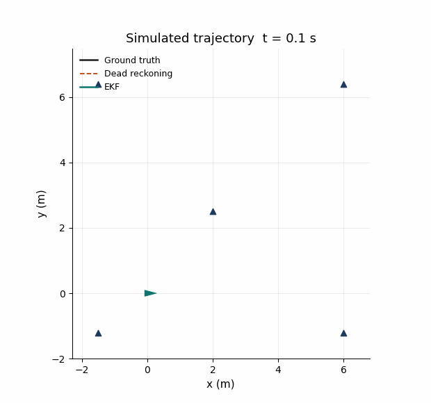

# ekfloc

[](https://github.com/a-haz/ekfloc/actions/workflows/ci.yml)

Extended Kalman Filter localization for a differential-drive robot in the plane.

The filter fuses wheel-odometry velocity with range and bearing observations of landmarks whose positions are known. Each observation carries a landmark id, so data association is known. A 2D simulator drives the robot on a fixed rounded-square course and adds configurable Gaussian noise to the odometry and to the landmark observations. Dead reckoning integrates that same noisy odometry and never sees the landmarks.

All results here, including the table, CSV files and figures, come from this simulator, not from a physical robot.

## Build

You need CMake 3.18 or newer, a C++17 compiler and Eigen 3.3 or newer. CMake downloads GoogleTest 1.15.2 while configuring the tests.

```bash
sudo apt-get install cmake g++ libeigen3-dev
cmake -S . -B build -DCMAKE_BUILD_TYPE=Release -DCMAKE_CXX_COMPILER=g++
cmake --build build --parallel
ctest --test-dir build --output-on-failure
```

## Run

One simulated run prints both scores. `--output` also writes a per-step trace.

```bash
./build/ekf_loc run --seed 1
./build/ekf_loc run --seed 1 --output /tmp/run.csv
./build/ekf_loc run --help
```

The benchmark runs seeds 1 through 8 on the fixed course and writes the summary used below.

```bash
./build/ekf_loc_benchmark \
  --output docs/benchmark.csv \
  --trace docs/sample_run.csv \
  --landmarks docs/landmarks.csv
```

Regenerate the figures from those files. This needs Python 3 with matplotlib, numpy, and pillow (`python3-matplotlib`, `python3-numpy`, and `python3-pil`).

```bash
python3 scripts/plot_benchmark.py \
  --benchmark docs/benchmark.csv \
  --trace docs/sample_run.csv \
  --landmarks docs/landmarks.csv \
  --trajectory docs/trajectory.png \
  --errors docs/error_over_time.png \
  --animation docs/trajectory.gif
```

## Models

The state is the pose \(\mathbf{x} = [x,\ y,\ \theta]^\top\), with \(\theta\) in radians. Wheel odometry is the body velocity \(\mathbf{u} = [v,\ \omega]^\top\).

One step uses the midpoint unicycle model:

\[
\begin{aligned}
\theta_m &= \theta + \tfrac{1}{2}\omega\,\Delta t \\
x' &= x + v\,\Delta t\cos\theta_m \\
y' &= y + v\,\Delta t\sin\theta_m \\
\theta' &= \theta + \omega\,\Delta t
\end{aligned}
\]

Linear velocity and yaw rate are treated as continuous-time white noise with power spectral densities \(q_v\) (m²/s³) and \(q_\omega\) (rad²/s³). Over a step the discrete input covariance is \(\mathrm{diag}(q_v/\Delta t,\ q_\omega/\Delta t)\), and the filter maps it through the control Jacobian \(G = \partial f/\partial\mathbf{u}\):

\[
Q = G\,\mathrm{diag}(q_v/\Delta t,\ q_\omega/\Delta t)\,G^\top
\]

A landmark at \((m_x, m_y)\) produces

\[
\begin{aligned}
r &= \sqrt{(m_x-x)^2 + (m_y-y)^2} \\
\phi &= \mathrm{atan2}(m_y-y,\ m_x-x) - \theta
\end{aligned}
\]

The bearing innovation is wrapped into \([-\pi,\ \pi)\). The covariance update uses the Joseph form. Normalized estimation error squared (NEES) is \(\mathbf{e}^\top P^{-1}\mathbf{e}\) with the heading component of \(\mathbf{e}\) wrapped the same way. A consistent 3-state filter has mean NEES near 3. Normalized innovation squared (NIS) for one range-bearing pair has mean near 2.

## Simulated scenario

The commanded course has a 28 s period and is repeated twice (56 s, \(\Delta t = 0.05\) s). Each leg is a 5 s straight segment at \(0.8\) m/s followed by a 2 s moving left turn at \(0.4\) m/s and \(\omega = \pi/4\) rad/s. With no noise the course closes.

Five landmarks sit around the path, each more than 1.5 m from it: \((-1.5,-1.2)\), \((6.0,-1.2)\), \((6.0,6.4)\), \((-1.5,6.4)\), and \((2.0,2.5)\). Range-bearing updates run at 5 Hz for every landmark inside 12 m.

Benchmark noise, shared by both estimators:

| Quantity | Value |
| --- | --- |
| \(q_v\) | 0.02 m²/s³ |
| \(q_\omega\) | 0.004 rad²/s³ |
| range std | 0.08 m |
| bearing std | 2 deg |
| initial covariance | \(\mathrm{diag}(0.02^2,\ 0.02^2,\ (0.5^\circ)^2)\) |

Both estimators start on the true pose. The true robot follows the commanded velocity. Odometry is that velocity plus the discrete noise above. Dead reckoning and the EKF predict with the same odometry sample; only the EKF applies the landmark updates.

## Tests

`ctest` runs 77 GoogleTest cases:

- angle wrapping, straight motion, in-place turns, and closure of the rounded-square course
- analytic motion and measurement Jacobians checked against central differences, including \(\omega = 0\), reverse motion, and headings near \(\pm\pi\)
- process-noise variance against the spectral-density discretization
- a bearing innovation that crosses the \(\pm\pi\) branch cut
- Monte Carlo NEES for prediction-only localization, and NEES plus NIS for the filter with landmark updates

## Benchmark results

The table is [`docs/benchmark.csv`](docs/benchmark.csv).

Definitions, evaluated on every 0.05 s step of that seed:

- `rmse_position_m`: square root of the mean squared horizontal error, in meters
- `rmse_heading_deg`: square root of the mean squared wrapped heading error, in degrees
- `final_position_error_m`: horizontal error at 56 s, in meters
- `final_heading_error_deg`: absolute wrapped heading error at 56 s, in degrees
- `mean_nees`: mean normalized estimation error squared

The `mean` row is the arithmetic mean of seeds 1 through 8.

| seed | method | rmse_position_m | rmse_heading_deg | final_position_error_m | final_heading_error_deg | mean_nees |
| --- | --- | ---: | ---: | ---: | ---: | ---: |
| 1 | dead_reckoning | 1.114044 | 6.205586 | 1.071653 | 0.923871 | 2.779755 |
| 1 | ekf | 0.058095 | 1.339858 | 0.012565 | 0.594767 | 3.157786 |
| 2 | dead_reckoning | 1.346017 | 10.661557 | 2.848870 | 13.305440 | 1.599025 |
| 2 | ekf | 0.058324 | 1.289777 | 0.002406 | 0.802747 | 3.575315 |
| 3 | dead_reckoning | 1.482178 | 26.579587 | 3.120918 | 33.999816 | 2.977582 |
| 3 | ekf | 0.053891 | 1.280369 | 0.039802 | 1.262137 | 3.074754 |
| 4 | dead_reckoning | 1.116854 | 7.332832 | 0.417820 | 3.894976 | 2.378923 |
| 4 | ekf | 0.055666 | 1.236593 | 0.042517 | 0.536608 | 2.890263 |
| 5 | dead_reckoning | 0.671842 | 9.479325 | 1.431617 | 9.922887 | 1.181934 |
| 5 | ekf | 0.052644 | 1.302433 | 0.018848 | 0.377043 | 2.852063 |
| 6 | dead_reckoning | 1.204769 | 16.860459 | 2.097918 | 26.448275 | 2.347710 |
| 6 | ekf | 0.054386 | 1.300064 | 0.023027 | 1.117882 | 2.622743 |
| 7 | dead_reckoning | 1.584462 | 17.380616 | 2.127006 | 15.607287 | 2.752592 |
| 7 | ekf | 0.057015 | 1.258604 | 0.011307 | 0.674394 | 3.108464 |
| 8 | dead_reckoning | 1.257299 | 11.259534 | 2.083262 | 2.337853 | 1.935327 |
| 8 | ekf | 0.054752 | 1.308044 | 0.002904 | 0.707446 | 2.967506 |
| mean | dead_reckoning | 1.222183 | 13.219937 | 1.899883 | 13.305051 | 2.244106 |
| mean | ekf | 0.055597 | 1.289468 | 0.019172 | 0.759128 | 3.031112 |

Over the eight seeds the EKF position RMSE is 0.056 m against 1.22 m for dead reckoning, and heading RMSE is 1.29 deg against 13.2 deg. The EKF mean NEES is 3.03, close to the value of 3 expected for a consistent filter.

The figures use seed 1 (`docs/sample_run.csv`).







## Layout

```
include/ekf_loc/    public headers
src/                library sources
apps/               ekf_loc and ekf_loc_benchmark
tests/              GoogleTest sources
scripts/            plot_benchmark.py
docs/               benchmark CSV, trace, and figures
.github/workflows/  CI
```

## License

MIT. See [LICENSE](LICENSE).
